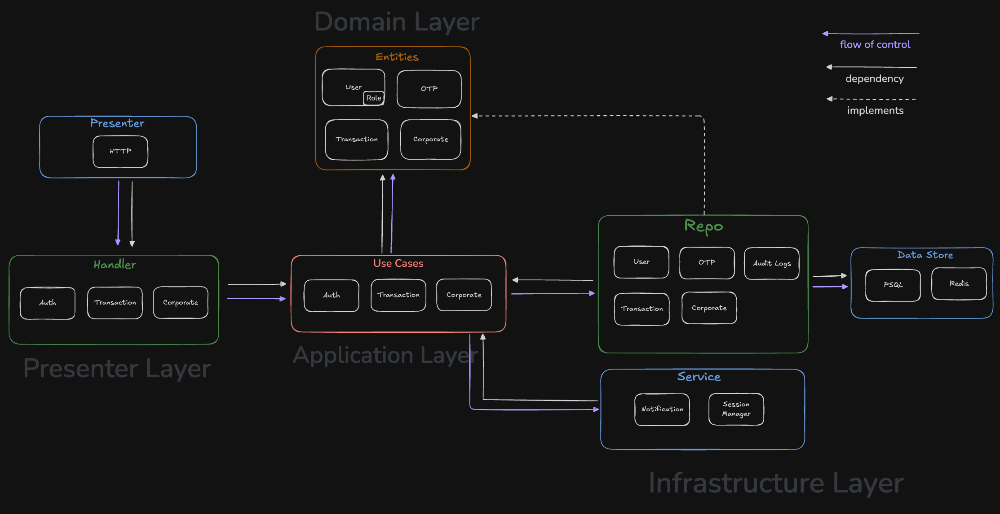
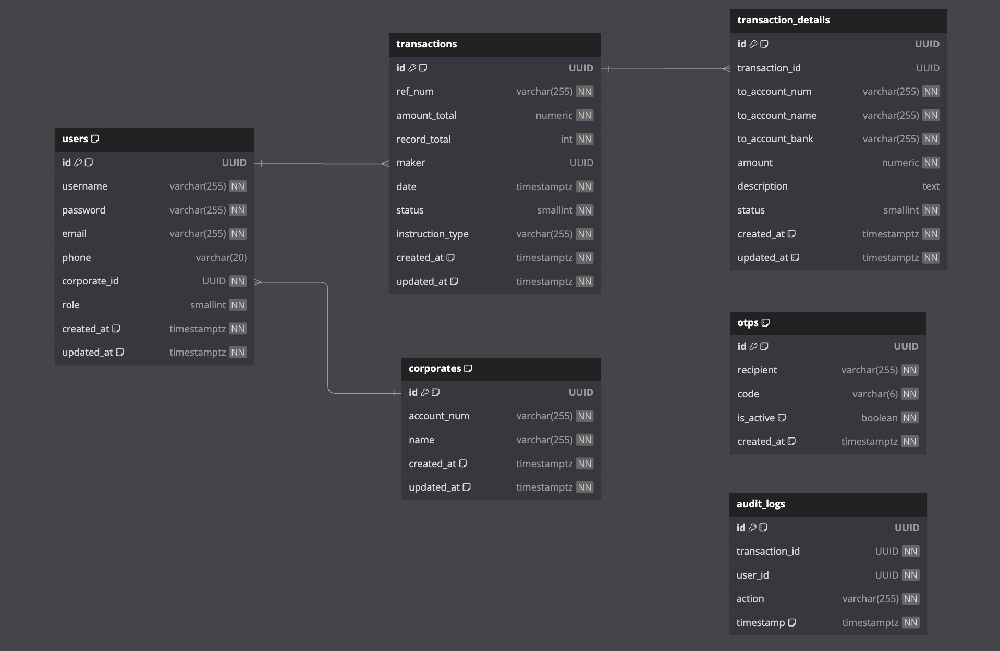

# banking-transaction-be

A REST API for corporate bank transfers with a **maker–checker** approval flow: makers upload batches of transfers from a CSV file, and approvers from the same company review and approve or reject them. Built in Go with clean architecture, PostgreSQL, Redis, and JWT authentication.

Frontend: [banking-transaction-fe](https://github.com/rizanw/banking-transaction-fe)

## Features

- **Maker–checker workflow**: makers submit transfers, approvers approve or reject them; nobody can approve with a maker account, and every decision is recorded in an audit log
- **Bulk transfers from CSV**: download a template, upload many transfers at once, and get per-row validation errors with row numbers
- **Immediate or scheduled transfers**: send now, or set a future transfer date
- **Corporate isolation**: users only see and act on their own company's transactions
- **Registration with email OTP**: one-time codes that expire after 10 minutes, can only be used once, and are limited to 5 wrong attempts per 15 minutes
- **JWT sessions with logout**: tokens are revoked on logout through a Redis blacklist
- **Filtering and pagination**: filter transactions by status and date range, plus per-status counts for dashboards

## How approval works

```
Maker                         API                                   Approver (same corporate)
  │  POST /transaction/upload   │                                          │
  ├────────────────────────────►│  status: Awaiting Approval               │
  │                             │◄─────────────────────────────────────────┤ GET /transactions
  │                             │◄─────────────────────────────────────────┤ POST /transaction/{id}/audit?action=approve
  │                             │  one DB transaction:                     │
  │                             │   1. status → Approved, only if still    │
  │                             │      Awaiting Approval                   │
  │                             │   2. same status on every transfer row   │
  │                             │   3. audit log with the approver's ID    │
```

The status change is conditional (`UPDATE … WHERE status = awaiting`), so if two approvers act at the same moment, exactly one succeeds and the other gets `409 Conflict`.

## API

All routes are under `/api`. Protected routes need `Authorization: Bearer <access_token>` from `/login`.

| Method | Route | Role | Description |
|---|---|---|---|
| `GET` | `/corporates` | public | list corporates (used by the registration form) |
| `POST` | `/send-otp` | public | email a registration code |
| `POST` | `/register` | public | create a maker (`role: 1`) or approver (`role: 2`) account |
| `POST` | `/login` | public | get an access token (valid 24 hours) |
| `POST` | `/logout` | any | revoke the current token |
| `GET` | `/transaction/download-template` | maker | CSV template |
| `POST` | `/transaction/upload` | maker | submit a batch from CSV (multipart form) |
| `GET` | `/transactions` | any | list your corporate's transactions (`status`, `start_date`, `end_date`, `page`, `per_page`) |
| `GET` | `/transactions/stats` | any | counts per status |
| `GET` | `/transaction/{id}` | any | transaction with its transfer rows |
| `POST` | `/transaction/{id}/audit?action=approve\|reject` | approver | approve or reject |
| `GET` | `/health` (no `/api` prefix) | public | health check |

Full request examples are in the [Postman collection](https://www.postman.com/navigation-candidate-18708542/workspace/banking-transaction).

### Upload format

```csv
to_bank_name,to_account_no,to_account_name,transfer_amount
BCA,1234567890,Budi,150000
BNI,9876543210,Sari,250000
```

The form also takes `instruction_type` (`immediate` or `standing`), `transaction_date` (Unix seconds, for `standing`), `total_record`, and `total_amount`. The server checks the totals against the file, so a truncated or edited file is rejected.

## Architecture

The code follows Uncle Bob's [Clean Architecture](https://blog.cleancoder.com/uncle-bob/2012/08/13/the-clean-architecture.html): business rules in `domain` and `usecase` don't depend on HTTP, PostgreSQL, or Redis, which are plugged in from the outer layers.



```
cmd/http/                 entry point: wiring, routes, auth middleware
internal/
├── domain/               entities, business rules, repository interfaces
├── usecase/              application logic (auth, transactions, corporates)
├── handler/http/         HTTP handlers: parse requests, map errors to status codes
├── repo/                 PostgreSQL implementations of the repositories
├── infra/                database, Redis cache, JWT sessions, SMTP
├── dto/                  request and response shapes, input validation
└── config/               YAML config with environment overrides
files/etc/tx-bank/        config.yaml
schema/                   SQL schema and seed data
```

### Database



## Getting started

Requires Go 1.19+, Docker, and `psql`.

```bash
git clone https://github.com/rizanw/banking-transaction-be.git
cd banking-transaction-be

make docker-up          # PostgreSQL on :5656 and Redis on :6379
./schema/setup.sh       # create tables and seed sample corporates

export JWT_SECRET=$(openssl rand -hex 32)
make run                # API on http://localhost:8080
```

Without SMTP credentials, the server prints OTP codes to its log instead of emailing them, so you can register locally right away. To send real emails:

```bash
export EMAIL=you@gmail.com
export EMAIL_PASSWORD=your-app-password
```

### Configuration

Settings live in [`files/etc/tx-bank/config.yaml`](files/etc/tx-bank/config.yaml). Secrets come from environment variables:

| Variable | Description |
|---|---|
| `JWT_SECRET` | key for signing tokens (32+ random bytes). If unset, a random key is generated at startup and everyone is logged out on restart. |
| `EMAIL`, `EMAIL_PASSWORD` | SMTP credentials for sending OTP codes |

`server.allowed_origins` restricts CORS to your frontend's origin (all origins are allowed by default).

## Known limitations

This is a portfolio project, not a production banking system:

- **Self-assigned roles**: anyone with a corporate's account number can register as a maker or approver. A real system would have an admin invite users and assign roles.
- **Public corporate list**: `/corporates` exposes account numbers so the registration form can offer a dropdown.
- **Floating-point amounts**: amounts are `float64` in Go. Production money handling should use integer minor units or a decimal type end to end.
- **No automated tests yet.**

## Tech stack

Go · gorilla/mux · PostgreSQL (sqlx, lib/pq) · Redis (go-redis) · JWT (golang-jwt) · bcrypt · Docker Compose
